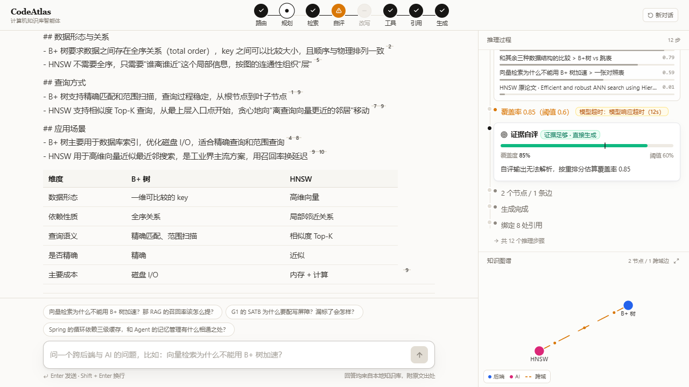
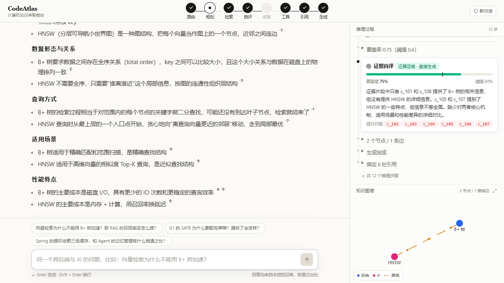
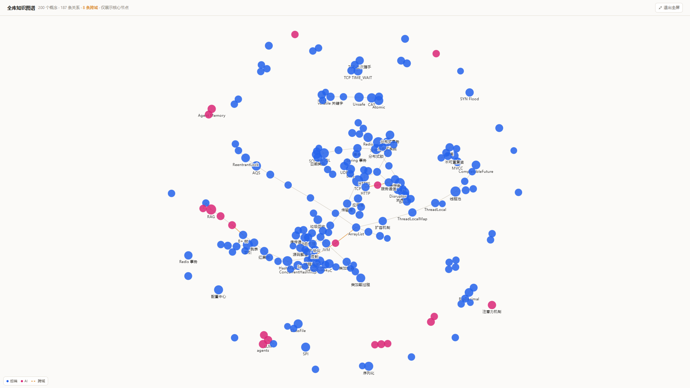

# CodeAtlas · 计算机知识库智能体

> 让 AI 走完一条**有出处、可追问、可验证**的学习路径。

面向计算机专业学生与后端求职者，知识库覆盖**后端（JVM / 并发 / MySQL / Redis / Spring / 网络 / 分布式）**与 **AI（LLM 基础 / RAG / Agent / 向量检索 / Prompt 工程）**两个域。不是又一个 AI 聊天框 —— 它会先规划要查什么、查几次，检索后自评证据是否足够，不够就改写查询重查，最后给出**逐句可溯源**的答案，并在知识图谱上点亮推理路径。

**它最特别的一点**：图谱里存在**跨域边**。当你问「向量检索为什么不能用 B+ 树加速」，它会把 AI 域的「HNSW」和后端域的「B+ 树」用一条虚线连起来 —— 纯向量检索做不到这件事，因为它不知道这两段知识该放在一起对比。

---

## 它解决什么问题

| 痛点 | 现有工具的失败之处 | CodeAtlas 的做法 |
|---|---|---|
| 八股答案碎片化、无法验证真伪 | 聊天框给不出「这句话出自哪本书第几节」 | claim 级引用，点角标跳原文高亮 |
| 知识点孤立，面试官追问一层就崩 | 单轮问答不会主动补上下文 | 多跳检索 + 知识图谱邻居扩展 |
| **后端和 AI 的知识各学各的，连不起来** | 向量检索按语义相似度召回，召不回「关系」 | **跨域边**：图谱显式记录两个学科间的对比/依赖关系 |
| 不知道自己的理解对不对 | 没有反馈闭环 | 出题器从图谱抽知识点，按引用评分 |

---

## 架构

```
浏览器 (React SPA)
      │  SSE (fetch + ReadableStream)
      ▼
┌─────────────────────────────┐
│ Java Gateway  :8080         │  唯一对外入口 /api/**
│ 会话·消息·文档元数据          │  SSE 透传 + 落库 + 断线续传
└──────────┬──────────────────┘
           │ HTTP SSE（内网，X-Internal-Token）
           ▼
┌─────────────────────────────┐
│ Python Agent  :8000         │  仅暴露 /internal/**
│ Agent 状态机 · 检索层 · 摄入 │
└──────────┬──────────────────┘
           ▼
   Postgres 16 + pgvector
```

详细设计见 [`contracts/`](contracts/) 与 [`docs/tech-doc/`](docs/tech-doc/)。

---

## 10 分钟极速复现

> 🚧 完整复现指南在 P5 阶段补齐。当前已完成数据库层，可独立验证。

三条路径，任选其一：

| 路径 | 前置条件 | 适合 |
|---|---|---|
| **A. 全量 Docker** | Docker Desktop | 完整体验（推荐） |
| **B. 前端 Mock 回放** | 只需 Node | 无网、无 Key 也能看完整交互 |
| **C. 在线 Demo** | 浏览器 | 最快 |

### 当前可用：数据库层

```bash
cp .env.example .env
docker compose up -d          # 只起 postgres + pgvector
```

验证建库是否正确（在一个事务里跑完并回滚，不留脏数据）：

```bash
docker exec -i codeatlas-db psql -U codeatlas -d codeatlas \
  -v ON_ERROR_STOP=1 -f - < db/smoke-test.sql
```

期望输出 5 个 ✓：向量写入、跨域边查询、外键约束、唯一约束、自环约束。

> ⚠️ `contracts/db-schema.sql` 只在数据卷为空时执行。改了 schema 要重建：
> `docker compose down -v && docker compose up -d`

### 当前可用：知识库摄入与检索

**不需要 API Key**——切片、BM25、向量全部本地跑。

```bash
# 1. 先把素材拉到 data/raw/（不进 git，版权原因只提交 manifest）
#    当前用的是 sparse checkout + GitHub Contents API，见下面「素材获取」

# 2. 只统计，不写库。先看切片质量再决定要不要入库
python scripts/ingest.py --dry-run

# 3. 确认没问题再落库（幂等，重复跑不会产生重复数据）
python scripts/ingest.py --apply

# 4. 下载本地 embedding 模型（bge-m3，约 2.2GB，走 ModelScope）
python scripts/fetch_model.py

# 5. 先验证模型能起来、维度对、语义排序正常（不要跳过）
python scripts/embed_chunks.py --dry-run

# 6. 编码全部 chunk（CPU 约 40 分钟，2.2 条/秒，幂等可断点续跑）
python scripts/embed_chunks.py --apply

# 7. 下载重排模型（可选，但要跑评测就得下；约 2.2GB）
python scripts/fetch_model.py --model BAAI/bge-reranker-v2-m3

# 8. 四种检索模式随便看
python scripts/search_test.py --mode hybrid     # 融合
python scripts/search_test.py --mode rerank     # 融合 + 重排

# 9. 跑评测，出数字
python scripts/eval_retrieval.py
```

**素材获取（当前的实际情况）**

原始文件不随仓库分发。JavaGuide（Apache-2.0）用 sparse checkout 只拉需要的目录：

```bash
git clone --depth 1 --filter=blob:none --sparse https://github.com/Snailclimb/JavaGuide.git /tmp/jg
cd /tmp/jg && git sparse-checkout set --no-cone 'docs/java/basis/*.md' 'docs/java/collection/*.md' ...
```

拉完按 `sources.manifest.yaml` 的 `id` 归档到 `data/raw/<id>/`。
`scripts/fetch_sources.py` 还没写——目前是手工执行，这一步还没自动化。

**当前数据量**（2026-10-26）：145 个文档 / 903 个 parent chunk / 5505 个 child chunk（全部有向量），
覆盖 **双域**：后端 9 个学科 5228 条 + AI 4 个学科 137 条（向量检索 39 / RAG 41 / Agent 40 / LLM 基础 17）。
child 平均 170 token，p95 290，超 256 预算的 8.5%——那些都是单个代码块或表格，
为了语义完整刻意不切。全部 5365 条已有 1024 维向量（bge-m3 本地推理）。

AI 域素材分两类：
- **自写 4 篇**（`notes/`，进仓库）：《向量检索为什么不能用 B+ 树加速》是演示主线的答案来源，
  公开资料里没有这个对比，必须自己写；另外三篇是 RAG 工程坑、Agent 循环、G1 SATB。
- **外部 6 篇**（`data/raw/`，gitignore）：HNSW 论文、RAG 论文、Anthropic/ Lilian Weng 的 Agent 文章等，
  excerpt 模式只保留节选，文件头写明来源和许可证。

**跨域检索验证**（演示主线的关键证据）：

| 查询 | 召回分布 |
|---|---|
| B+ 树和 HNSW 的区别是什么 | AI 域 5 条 + 后端域 3 条（MySQL / Redis） |
| 向量索引和数据库索引有什么不同 | 后端域 6 条（MySQL）+ AI 域 1 条 |

**检索评测**（37 题：29 道关键词题 + 8 道语义题，其中后端 20 道、AI 17 道，候选池 5505）

| 模式 | 总体 Hit@1 | 总体 Recall@5 | 后端 Recall@5 | AI Recall@5 | AI Hit@1 |
|---|---|---|---|---|---|
| BM25 | 51.4% | 81.1% | 85.0% | 76.5% | **58.8%** |
| 向量 | 43.2% | 81.1% | 80.0% | 82.4% | 52.9% |
| 混合（RRF） | 51.4% | 91.9% | **95.0%** | 88.2% | 64.7% |
| **混合 + 重排** | **78.4%** | **94.6%** | 90.0% | **100.0%** | 82.4% |

**怎么读这张表**（这部分比数字本身重要）：

1. **BM25 在关键词题上很强**（58.6% Hit@1）。问「SATB」「AQS」这种罕见缩写，
   精确词命中就是最强信号，向量反而会被「G1 收集器」这类高频主题词带偏。

2. **混合的价值在召回率**。91.9% 的总体 Recall@5，后端域做到 95%——
   同时拿到了 BM25 的关键词召回和向量的语义召回。

3. **混合的 Hit@1 没提升**（51.4%，和 BM25 持平）。RRF 只看排名，
   BM25 那个又准又强的第一名被向量中段的结果稀释了。
   **调 RRF 的 k 修不了**（k=1/3/5/10/20/60 全试过），
   **用分数门控也修不了**（关键词题 10~44 分、语义题 15~20 分，分布完全重叠）。

4. **重排把 Hit@1 从 51.4% 拉到 78.4%**，而且对 AI 域收益最大（Recall@5 88.2% → 100%）。
   代价是延迟：CPU 上 12 个候选 × 256 token 约 5 秒。

5. **语义题是短板**（重排后 Hit@1 62.5%）。口语化提问和章节标题之间的措辞差距，
   靠重排也补不回来——这需要 query 改写或更好的中文语料，不是调参数能解决的。

**一个被数据推翻的结论**（值得单独说）：

上一版 33 题时，AI 域的 BM25 明显落后于向量（Hit@1 46.2% vs 61.5%），
我当时的解释是「AI 素材是英文论文，词匹配跨不过语言差异」。
补了两篇中文笔记、加了 4 道题之后，这个差距反过来了：BM25 58.8% vs 向量 52.9%。

说明当时的归因是对的，但结论说反了：**BM25 的劣势来自跨语言，不是来自「AI 领域」本身**。
素材换成中文，字面匹配立刻恢复竞争力（中文术语「注入」「RoPE」区分度很高）。
反过来说，向量检索的优势主要体现在**表述差异大**的场景（语义题），而不是"专业领域"。

**素材补充的效果**（同一套题、同一套参数，只改语料）：

| 指标 | 补素材前（33 题） | 补素材后（37 题，含新增 4 题） |
|---|---|---|
| AI 域 Recall@5 | 84.6% | **100%** |
| 总体 Recall@5 | 87.9% | **94.6%** |

两篇中文笔记共 28 个 chunk，占语料 0.5%。这个对比本身就是结论：
**调检索参数之前先确认素材覆盖度**。诚实说明：新增的 4 道题正是照着补的素材出的，
提升幅度有自证成分，但它确实补上了中文表述这层映射。

**最终架构：混合检索取前 20 → 重排取前 8 喂给生成。**
召回靠混合（95%），排序靠重排（75% Hit@1），两者不冲突。

> 评测集在 `eval/gold_set.yaml`。判相关用可判定的关键词/标题条件，
> 不追求绝对准确，追求**三种模式面对同一把尺子**。
> 已知局限：关键词判定天然偏袒 BM25，所以语义题单独用标题判定，分开统计。

### 当前可用：Agent 服务

两种模式，由 `.env` 的 `MOCK_AGENT` 切换：

| 模式 | 依赖 | 答案 |
|---|---|---|
| `MOCK_AGENT=true`（默认） | 无 | 预录的固定答案，用于演示前端和契约 |
| `MOCK_AGENT=false` | `LLM_API_KEY` | 真实推理：检索是真的，答案是模型生成的 |

```bash
cd services/python-agent
uvicorn app.main:app --reload --port 8000
```

#### 接真实模型（P2）

默认用**智谱 GLM-4.5-Flash，免费**。注册 https://bigmodel.cn 后创建 API Key：

```bash
# .env
LLM_API_KEY=你的key
AGENT_MODEL=glm-4.5-flash      # 注意不是上一代的 glm-4-flash
MOCK_AGENT=false
```

先验证 key 和模型名（最省 token 的检查）：

```bash
python scripts/agent_smoke.py --ping
```

再跑完整链路，不依赖前端和 Java，直接打印事件时间轴：

```bash
python scripts/agent_smoke.py --question "向量检索为什么不能用 B+ 树加速"
```

**Agent 的六个节点**（`services/python-agent/app/agent/`）：

```
router → planner → retriever → grader ─┬→ generator
                        ↑              │
                        └── rewriter ←─┘（覆盖率不足时）
```

- `router` 意图分类（concept/compare/debug/quiz/chitchat）
- `planner` 拆 2~4 个检索子查询 + 抽实体
- `retriever` **真实混合检索**（BM25 + 向量 + 重排），多子查询合并后**只重排一次**
- `grader` 自评覆盖率，低于阈值（0.6）触发改写
- `rewriter` 换角度重查，最多 2 轮
- `generator` 流式生成，`[n]` 角标绑定到真实 chunk

**三个工程细节**（细节决定演示会不会翻车）：

1. **重排只做一次**。单次重排 12 条候选约 5 秒；4 个子查询各排一次就是 20 秒。
   所以每个子查询只做融合召回（约 50ms），合并去重后统一重排。
2. **引用编号由代码建立**。证据按 `[1][2]` 编号写进 prompt，模型只能引用已存在的编号；
   越界编号（如 `[99]`）保留在正文里但不发 `citation`，前端显示「无出处」。
3. **跨域边由 domain 计算**，不看模型输出。这是产品的核心视觉证据，不能让模型随口判断。

**降级矩阵**（任一节点失败都不中断流）：JSON 解析失败 → 该节点标 `degraded` 继续；
模型超时 → 重试 1 次后降级；检索为空 → `error(RETRIEVAL_EMPTY)` + `done`；
生成失败 → 抽取式兜底（把证据原文拼出来）。

健康检查（`db` 应为 `ok`，`llm` 为 `missing_key`，`mode` 为 `mock`）：

```bash
curl -H "X-Internal-Token: $INTERNAL_TOKEN" http://127.0.0.1:8000/internal/health
```

看完整事件流（51 个事件，约 2 秒）：

```bash
curl -N -X POST http://127.0.0.1:8000/internal/agent/stream \
  -H "X-Internal-Token: $INTERNAL_TOKEN" \
  -H "Content-Type: application/json" \
  -d '{"trace_id":"t_demo","question":"向量检索为什么不能用 B+ 树加速？"}'
```

跑协议一致性测试（13 个用例，守住 `contracts/sse-events.md` 的 5 条顺序保证）：

```bash
cd services/python-agent && pytest -v
```

### 当前可用：Java 网关

```bash
# ⚠️ 必须先加载 .env，否则数据库密码用的是 application.yml 里的占位默认值，连不上
set -a && source .env && set +a
cd services/java-gateway && mvn spring-boot:run
```

端到端验收（健康检查 → SSE 流 → 落库，三段全过才算 P0 完成）：

```bash
python scripts/e2e_check.py
```

**排障提示**

| 现象 | 原因 | 处理 |
|---|---|---|
| Tomcat 起在随机端口、报 `already in use` | 环境里存在 `SERVER_PORT` 变量，优先级高于 `application.yml` | 显式传 `-Dspring-boot.run.arguments=--server.port=8080` |
| 数据库连接失败 | 忘了 `source .env`，用了 yml 里的占位密码 | 启动前先 `set -a && source .env && set +a` |
| HTTP 200 但前端收不到事件 | SSE 帧 `event:step` 与 `event: step` 两种写法只认了一种 | 解析器必须容忍冒号后有无空格，见 `contracts/sse-events.md` |
| `git clone` 报 `CONNECT tunnel failed, response 502` | 环境变量里挂着失效的 HTTP 代理，curl 加了 `--noproxy` 但 git 没绕过 | `env -u HTTP_PROXY -u HTTPS_PROXY git ...` |
| `raw.githubusercontent.com` 打不开，但 `github.com` 正常 | 部分 DNS 污染，raw 域名被拦 | 走 `codeload` 下 tarball，或用 `api.github.com` 的 Contents API 取 base64 内容 |

### 路径 A：全量 Docker（P3 后可用）

```bash
docker compose --profile app up -d
# 打开 http://localhost:5173
```

数据库镜像将内置知识库快照（含 embedding），**不需要重新建库，不需要 API Key 也能看到完整数据**。

### 当前可用：前端

两种跑法：**只看界面**（mock，零依赖）和**跑真实链路**（三端联调）。

#### 跑法一：只看界面（不需要后端和 API Key）

```bash
cd web && npm install && npm run dev
# 打开 http://localhost:5173
```

默认走 mock 流（`web/.env.development` 里 `VITE_MOCK=1`），加载 `web/src/mock/stream.jsonl`，
**不需要数据库、不需要启动 Java/Python、不需要任何 API Key**，就能看到完整的流式问答。

接真实链路时把 `VITE_MOCK` 改成 `0`，先起 Java 8080 与 Python 8000。

**几个开发期入口**

| 入口 | 用途 |
|---|---|
| `http://localhost:5173/?q=<问题>` | 带问题直接打开（演示和自动化截图用） |
| `http://localhost:5173/graph-preview.html` | 单独看知识图谱渲染，调样式不用跑完整流程 |
| `npm test` | SSE 解析器单测（13 个用例，含对真实 mock 流的顺序校验） |
| `npm run typecheck` | 类型检查 |

**这份 mock 不是手写的。** `scripts/gen_mock_stream.py` 直接跑 Python 的 `mock_runner`，
把 SSE 帧解析成 jsonl 落盘，所以事件顺序与真实链路逐字节一致。
改了 `mock_runner` 之后重跑一次脚本即可，前端自动跟上：

```bash
python scripts/gen_mock_stream.py
```

#### 跑法二：真实链路（三端）

按顺序起三个服务，然后浏览器里问问题，答案来自真实检索 + 真实模型：

```bash
# 1. 数据库
docker compose up -d db            # 或 docker desktop start 后等 codeatlas-db healthy

# 2. Python Agent（8000）
cd services/python-agent
uvicorn app.main:app --port 8000

# 3. Java 网关（8080）—— 必须显式指定端口，环境里的 SERVER_PORT 会覆盖配置
cd services/java-gateway
java -jar target/java-gateway-0.1.0.jar --server.port=8080

# 4. 前端（5173），关掉 mock
cd web && VITE_MOCK=0 npx vite --port 5173
```

**一条命令验证整条链路**（查健康 + 跑真实问答 + 断言 SSE 契约）：

```bash
python scripts/e2e_verify.py --strict-cross-domain
```

它会把事件流打印成时间轴，并检查：`done` 收尾、`seq` 单调、`plan` 先于 `retrieval`、
`citation` 先于含 `[n]` 的 token、演示主线题必须有跨域边。

**实际效果**（热态约 25 秒）：





左边是答案（对比表格里的 `[5] [7]` 角标可点，点开是原文出处），
右上是思考面板（每个节点逐一点亮，自评覆盖率 0.85，低分片段编号列出来），
右下是知识图谱（`B+ 树` ←→ `HNSW` 之间的橙色虚线就是跨域边）。

**演示脚本**：`docs/demo-script.md`（6 分钟分镜 + 30 秒电梯版 + 意外情况应对 + 评委 10 问）。

**演示时值得讲的三点**：

1. **跨域边是系统自己连的**。问题里没有「B+ 树」三个字，是检索同时命中了
   AI 域和后端域，图谱才连出这条边。纯向量检索做不到——「B+ 树」这个词不在问题里。
2. **自评-改写是真的会触发**。问库里没有的内容（比如 Kubernetes 调度器），
   覆盖率会掉到 0.2，系统改写两轮后放弃，答案开头直接写「现有资料不足以完整回答」。
3. **降级是可见的**。模型超时的时候节点会标成黄色（`degraded`）而不是红色报错，
   流程继续跑完——比如自评超时就用重排分估一个覆盖率。

---

## 技术栈

Spring Boot 3.5 · MyBatis-Plus · FastAPI · SQLAlchemy 2.0 · Postgres 16 + pgvector
React 18 · Vite 6 · TypeScript · Tailwind 3.4 · react-force-graph
DeepSeek V4.1-Flash · BGE-M3 · bge-reranker-v2-m3

---

## 响应速度优化

优化前实测 **31.0s**（热态），拆开看每一段在干什么：

| 阶段 | 优化前 | 优化后 | 改了什么 |
|---|---|---|---|
| router | 0.8s | **0.0s** | 关键词规则替代模型调用 |
| planner | 2.1s | 4.5s | 未改（模型波动） |
| retriever | 4.5s | 4.1s | 未改 |
| grader | **12.0s** | **0.0s** | 证据充足时直接判定 |
| graph | 0.03s | 0.03s | 未改 |
| generator | 11.6s | **4.7s** | 证据 12→6 条，输入砍一半 |
| **合计** | **31.0s** | **13.3s** | **−57%** |

**核心判断：链路里 5 次模型调用，有 2 次是可以不算的。**

- **router**：输出只有 5 个枚举值，实际作用只是拼进 planner 的提示词 + 界面一个标签。
  用关键词判（对比词→compare、报错词→debug、短问候→chitchat），判错的代价接近零。
  唯一要小心的是 chitchat——它会让整条检索被跳过，所以只在 ≤12 字的短问题里判。
- **grader**：任务是判断「证据够不够」，而重排分本身就是「这条证据有多相关」。
  前三条重排分均值 ≥0.75 且证据 ≥6 条时，结论必然是 proceed，问模型只是花 3~12 秒买同一个结论。
  **证据少、分数低时才走模型**——那才是真正需要判断要不要改写的场景。

两处都保留了开关（`AGENT_RULE_ROUTER`）和降级路径，不是硬编码。

**另外两项：**

- **启动预热**：BM25(2s) + embedding(8s) + rerank(5s) 从「第一个请求」挪到「服务启动」。
  冷启动首个问题从 40~60s 降到和热态一致，代价是启动慢 25 秒。
- **生成瘦身**：检索召回 12 条，答案实际只引用前 6 条，剩下 6 条白占 prompt——
  而输入长度直接决定首 token 延迟。实测输入 token 2568 → 1506（−41%）。

**没有做的事，以及为什么：**

- **重排瘦身（12→8 候选）**：只值 2 秒，但会让 Hit@1 有掉点风险。已经 13.3s 了，不值得。
- **换更快的模型**：能解决排队（429），但解决不了「调了几次」和「输出多长」。
  两者是叠加关系，先做确定性的结构优化更划算。

---

## 全库知识图谱

单次问答的图谱是**临时生成**的（实体来自规划节点的抽取）。全库图谱是**离线构建**的，
两者用同一套判定规则，所以长得一样、跨域边的含义也一样。

```bash
python scripts/build_graph.py            # 全量构建（可断点续跑，已抽过的跳过）
python scripts/build_graph.py --limit 3  # 先试 3 篇看质量
python scripts/build_graph.py --load-only  # 只把缓存灌进库
```

**为什么是「每篇文档调一次模型」而不是「每个 chunk 调一次」**：
5484 个 chunk 逐个抽要 4.5 小时；按文档抽是同一语义粒度的合理近似，
调用量从 5484 降到 143。并发 4 跑完全量约 15 分钟。

**为什么不用章节标题直接当概念**（试过，放弃了）：
标题里混着大量非概念——「完整代码以及测试」「按准备时间安排复习」「参考」。
抽出来的图全是这种节点，比没有图更糟。

**两道防幻觉校验**：概念必须在正文里真实出现（归一化后子串匹配），
边的两端必须都在保留下来的概念里。模型编的词直接丢掉。

**学科的判定用全库众数**：同一个概念可能被多个学科提到，出现最多的那个才算它的归属。
和请求时图谱的规则一致——两处用不同规则的话，全库图和单题图会互相矛盾。

**实测规模**：145 篇文档 → 727 个概念 / 538 条关系，其中 **16 条跨域**。
前端顶栏的「全库图谱」按钮就是它（`GET /api/graph/overview`，默认展示度数最高的 200 个节点）。



蓝色是后端域、粉色是 AI 域，橙色虚线是跨域边。**两个域各自聚成一团**——
这正是普通向量检索看不见的结构：它只知道两段话像不像，不知道它们属于两个世界。

抽取结果缓存在 `data/graph/*.json`（已提交），所以别人 clone 下来不用重新调模型，
`--load-only` 就能把图灌回数据库。

---

## 接口实现状态

契约（`contracts/openapi.yaml`）定义了 16 个端点。**实现了 14 个，两个明确不实现**——
宁可标成未实现，也不做一个返回空数组的假接口。

| 端点 | 状态 | 说明 |
|---|---|---|
| `POST /api/chat/stream` | ✅ | SSE 主链路，Java 转发 + 注入 message_id / session_id |
| `GET /api/sessions` | ✅ | 会话列表 |
| `POST /api/sessions` | ✅ | 新建会话 |
| `GET /api/sessions/{id}/messages` | ✅ | 会话消息 |
| `GET /api/subjects` | ✅ | 15 个学科 + 各自切片数，前端显示"资料充足度" |
| `GET /api/documents` | ✅ | 143 篇文档，支持按 status 过滤 |
| `DELETE /api/documents/{id}` | ✅ | 级联删除切片与向量 |
| `GET /api/chunks/{id}` | ✅ | 引用角标点开看原文，`c_102` 和 `102` 都收 |
| `GET /api/traces/{id}` | ✅ | 轨迹回放：14 步、每步耗时、降级原因 |
| `GET /api/eval/runs` | ✅ | 四种检索模式的评测结果 |
| `POST /api/feedback` | ✅ | 点踩原因，rating 只允许 -1/1 |
| `GET /api/health` | ✅ | 网关 / 数据库 / Agent 三处探活 |
| `POST /api/documents` | ❌ | 文件上传要落盘 + 异步入库，当前用 `scripts/ingest.py` 批量入库 |
| `GET /api/graph/overview` | ✅ | 全库图谱，按度数取核心节点，支持按学科过滤 |
| `GET /api/graph/neighbors` | ✅ | 以某概念为中心看 1~2 跳邻居 |
| `POST /api/eval/runs` | ❌ | 评测结果由 `scripts/eval_retrieval.py` 直接写库，不需要 HTTP 入口 |

**为什么没有 `/internal/ingest`**：契约里写了，但入库是离线批处理（`scripts/ingest.py`），
做成 HTTP 接口只是把批处理包装成同步请求，反而更容易超时。

---

## 开发进度

- [x] P0 骨架与契约（数据库层 / Agent Mock / Java 网关 / E2E 20 项全过）
- [x] P3-a 前端骨架与流式渲染（对话流 · 思考面板 · 图谱 · 引用 · Mock 回放）
- [x] P1-a 知识库摄入与 BM25 基线（131 文档 / 5219 child chunk）
- [x] P1-b 本地向量检索 + RRF 混合检索（44 个单测 / 20 题评测集）
- [x] P1-c 重排（Hit@1 从 40% → 75%，MRR 0.609 → 0.822）
- [x] P1-d 素材补齐：AI 域 6 篇外部 + 4 篇自写，双域打通
- [x] P2 Agent 状态机（智谱 GLM-4.5-Flash，6 节点全链路）
- [x] P3-b 前端接真实链路（表格渲染 / 标题层级 / 多轮对话）
- [x] P3-c 前端视觉打磨（图谱面板尺寸 / 视野适配 / 会话刷新恢复）
- [ ] P4 打磨与冻结
- [ ] P5 参赛材料

---

## 数据来源与许可

本项目知识库仅使用**明确开源协议**的资料，原始文件不随仓库分发，由 `scripts/fetch_sources.py` 按 `sources.manifest.yaml` 拉取。

| 来源 | 域 | 许可证 | 入库方式 |
|---|---|---|---|
| JavaGuide（Snailclimb） | 后端 | **Apache-2.0** | 全文 |
| MySQL 8.0 Reference Manual | 后端 | 官方文档 | 结构化摘录 |
| Redis Documentation | 后端 | 官方文档 | 结构化摘录 |
| Qdrant Documentation | AI | **Apache-2.0** | 全文 |
| Prompt Engineering Guide（DAIR.AI） | AI | **MIT** | 全文 |
| HNSW 原论文（Malkov & Yashunin, arXiv:1603.09320） | AI | arXiv 预印本 | 结构化摘录 + 链接 |
| RAG 原论文（Lewis et al., arXiv:2005.11401） | AI | arXiv 预印本 | 结构化摘录 + 链接 |
| Anthropic《Building Effective Agents》 | AI | 版权归 Anthropic | 结构化摘录 + 链接 |
| Lilian Weng《LLM Powered Autonomous Agents》 | AI | 版权归作者 | 结构化摘录 + 链接 |
| The Illustrated Transformer（Jay Alammar） | AI | 版权归作者 | 结构化摘录 + 链接 |
| LlamaIndex《Production RAG》 | AI | 官方文档 | 结构化摘录 + 链接 |
| 本人学习笔记（4 篇） | 后端 / AI | 原创 | 全文 |

**入库方式说明**：只有 Apache-2.0 / MIT 这类允许全文使用的源才整篇入库；其余一律只保留**自己重写的结构化摘录 + 原文链接**，不转存原文。这样既规避版权风险，也让知识库内容本身构成原创。

原始文件**不随仓库分发**，由 `scripts/fetch_sources.py` 按 [`sources.manifest.yaml`](sources.manifest.yaml) 拉取。

> 注：本清单刻意**未采用 CS-Notes**——它的许可证是 CC BY-NC-SA 4.0，含「不可商用」与「相同方式共享」条款，与参赛作品的授权方式存在冲突。JavaGuide（Apache-2.0）已覆盖后端各学科，无需它补充。

署名与完整清单见 [`sources.manifest.yaml`](sources.manifest.yaml)。

---

## 参赛信息

2026 传智杯 · 全国高校 Vibe Coding 开发挑战赛 · 省赛 · B 组
开发过程与 Prompt 记录见 [`docs/prompts/`](docs/prompts/)。
